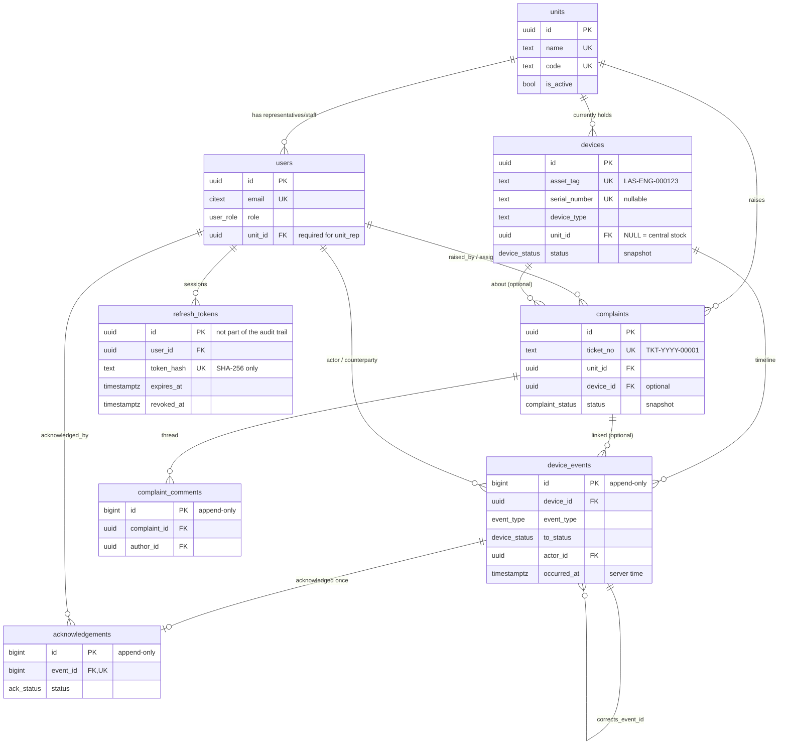

# Entity Relationship Diagram

Source of truth: [`alembic/versions/0001_initial_schema.py`](../backend/alembic/versions/0001_initial_schema.py)
(SPEC.md section 4), [`0002_refresh_tokens.py`](../backend/alembic/versions/0002_refresh_tokens.py) and
[`0003_remove_pricing.py`](../backend/alembic/versions/0003_remove_pricing.py) and
[`0006_remove_vendors.py`](../backend/alembic/versions/0006_remove_vendors.py). Tables marked
**append-only** reject `UPDATE`, `DELETE` and `TRUNCATE` at the database level.

The system records no monetary values (SPEC v1.1), so there is no costs table. Repairs are done
in-house (SPEC v1.2), so there is no vendors table.

## Guard behaviour

`device_events`, `acknowledgements` and `complaint_comments` reject `UPDATE`, `DELETE` and
`TRUNCATE` (also via `CASCADE`). All guard exceptions use SQLSTATE `23001`
(`restrict_violation`), so the service layer can catch them by code.
